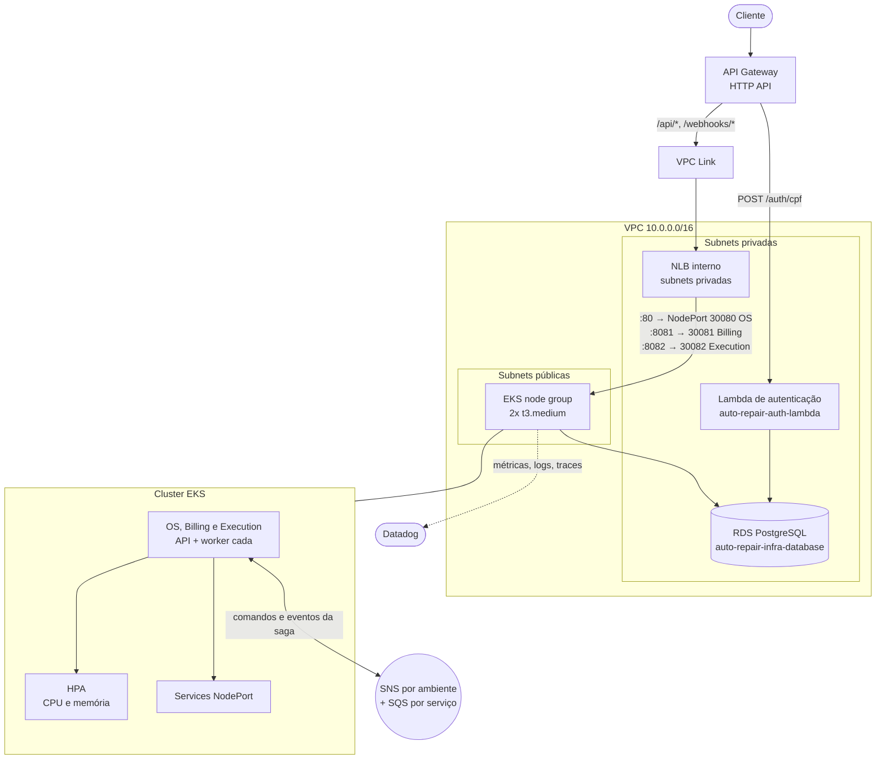

# auto-repair-infra-k8s

Infraestrutura de rede, cluster Kubernetes e borda de entrada do sistema de
gestão de oficina mecânica (Tech Challenge, fases 3 e 4, FIAP postech).

Este é o **primeiro** repositório a ser aplicado: ele cria a VPC e a plataforma
compartilhada pelos três microsserviços (OS, Billing e Execution) e publica, via
estado remoto, as saídas que os demais consomem. Ele só cria o que é comum: cada
serviço provisiona a própria fila, DLQ, IAM e banco no seu repositório.

## Propósito

| Componente | Função |
|---|---|
| VPC | Rede isolada, 2 AZs, subnets públicas (nós) e privadas (RDS, Lambda, NLB) |
| EKS | Cluster Kubernetes gerenciado, com node group e metrics-server para o HPA |
| ECR | Um repositório de imagem por serviço (`auto-repair-api`, `-billing-service`, `-execution-service`) |
| NLB interno | Recebe o tráfego do API Gateway, com um listener por serviço (OS :80, Billing :8081, Execution :8082) apontando para o NodePort de cada um (30080, 30081, 30082) |
| API Gateway (HTTP API) | Borda pública: `/auth/cpf` para a Lambda; `/api/v1/budgets`, `/api/v1/payments` e `/webhooks/mercadopago` para o Billing; `/api/v1/parts` e `/api/v1/executions` para o Execution; o restante de `/api/*` para o OS |
| SNS | Um tópico de eventos da saga por ambiente (`auto-repair-<env>-events`); as filas de cada serviço assinam com filtro por `destination` |
| VPC Link | Ponte entre o API Gateway e o NLB interno |
| IAM OIDC | Role assumida pelo GitHub Actions de todos os repositórios, sem chave de longa duração |
| EKS Pod Identity | Agente instalado no cluster; cada serviço associa a própria role ao seu ServiceAccount |
| Datadog | Agent (DaemonSet de métricas, logs e APM), dashboards da aplicação e da saga e monitores (falha de compensação, pico de compensações, falhas de consumo, uptime, latência) |

## Arquitetura



## Tecnologias

Terraform 1.10+, AWS (VPC, EKS, ECR, ELBv2, API Gateway v2, SNS, IAM), Helm, Datadog provider,
módulos `terraform-aws-modules/vpc` e `terraform-aws-modules/eks`.

## Pré-requisitos

1. Bucket de estado remoto criado — ver [`bootstrap/README.md`](bootstrap/README.md)
2. Perfil AWS configurado: `aws configure --profile auto-repair`
3. Terraform 1.10 ou superior

## Execução

```bash
make init
make plan
make up          # ~15-20 min: o control plane do EKS é o passo demorado
make kubeconfig  # configura o kubectl para o cluster
make outputs     # imprime as saídas consumidas pelos outros repositórios
```

Para destruir tudo:

```bash
make down
```

> **Custo.** Este repositório provisiona os recursos mais caros do projeto:
> control plane do EKS (US$ 0,10/h, sem free tier), nós EC2 e NLB. Rodando 24/7
> a conta fica em torno de US$ 136/mês. Provisione para testar ou gravar e
> rode `make down` em seguida. Há um AWS Budget com alerta em US$ 10.

## Ordem de aplicação entre os repositórios

```
bootstrap (manual)
   └─► auto-repair-infra-k8s        (este repositório — cria a VPC)
          └─► auto-repair-infra-database   (RDS, lê a VPC do estado remoto)
                 └─► auto-repair-auth-lambda  (Lambda, lê VPC e banco)
                        └─► auto-repair-api, auto-repair-billing-service,
                            auto-repair-execution-service
                            (cada pipeline aplica o Terraform do serviço e faz o deploy)
```

## Saídas publicadas

`vpc_id`, `public_subnet_ids`, `private_subnet_ids`, `vpc_cidr`,
`cluster_name`, `cluster_endpoint`, `node_security_group_id`,
`ecr_repository_url`, `ecr_repository_urls`, `node_ports`, `events_topic_arns`,
`api_gateway_url`, `api_gateway_id`, `api_gateway_execution_arn`,
`github_actions_role_arn`, `api_node_port`, `datadog_dashboard_url`,
`datadog_saga_dashboard_url`.

Consumidas pelos demais repositórios via `terraform_remote_state`.

## CI/CD

`.github/workflows/terraform.yml`:

- **Pull request e push** → `validate`: `fmt -check`, `init -backend=false` e `validate`, sem AWS
- **`plan`** e, na `main`, **`apply`** automático: só rodam quando a variável de
  repositório `DEPLOY_ENABLED` vale `true`, porque o ambiente AWS só fica de pé durante
  testes e demonstrações. Com ele no ar, podem ser disparados por *Run workflow*

A autenticação com a AWS usa **OIDC**: o workflow assume a role
`auto-repair-github-actions` por token de curta duração, sem access key
armazenada nos Secrets do GitHub.

> O **primeiro** apply precisa ser local, porque é ele quem cria a role que o
> CI assume. A partir daí o pipeline é autossuficiente.

## Variáveis

| Variável | Padrão | Descrição |
|---|---|---|
| `project` | `auto-repair` | Prefixo dos recursos |
| `region` | `us-east-1` | Região AWS |
| `vpc_cidr` | `10.0.0.0/16` | CIDR da VPC |
| `kubernetes_version` | `1.31` | Versão do EKS |
| `node_instance_type` | `t3.medium` | Tipo dos nós |
| `node_desired_size` / `node_max_size` | `2` / `4` | Tamanho do node group |
| `api_node_port` / `billing_node_port` / `execution_node_port` | `30080` / `30081` / `30082` | NodePort de cada serviço, alvo do NLB |
| `environments` | `prod`, `homolog` | Um tópico SNS por ambiente |
| `github_repositories` | todos os repositórios | Repositórios autorizados a assumir a role de CI |
| `datadog_api_key` | `""` | Vazio desativa o agente |
| `datadog_app_key` | `""` | Necessária para criar dashboards e monitores |
| `datadog_site` | `datadoghq.com` | Site da conta Datadog |
| `datadog_alert_email` | | Destino dos alertas |

## Decisões

Registradas como ADRs em [`auto-repair-api/docs/adr`](https://github.com/IgorSantosXP/auto-repair-api/tree/main/docs/adr).
Em resumo:

- **Sem NAT Gateway.** Nós em subnets públicas com IP público; RDS e Lambda em
  subnets privadas sem saída para a internet. Economiza US$ 32/mês sem expor o
  banco.
- **NLB com alvos por instância, criado no Terraform** em vez de um Service
  `type=LoadBalancer`. Evita a dependência circular entre o cluster e o API
  Gateway, que precisa do ARN do listener.
- **Lock de estado nativo do S3** (`use_lockfile`), dispensando DynamoDB.

## Documentação arquitetural

Diagramas, ADRs, RFCs e modelo de dados do sistema completo:
**[índice da documentação](https://github.com/IgorSantosXP/auto-repair-api/tree/main/docs)**.

## API

A collection da API fica no repositório da aplicação:
[Swagger UI](https://github.com/IgorSantosXP/auto-repair-api#documentação-da-api).
